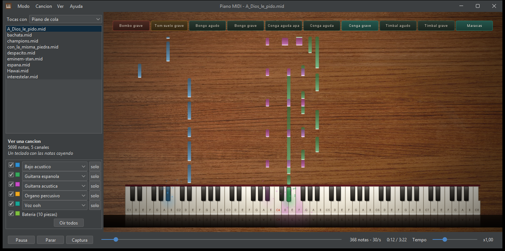
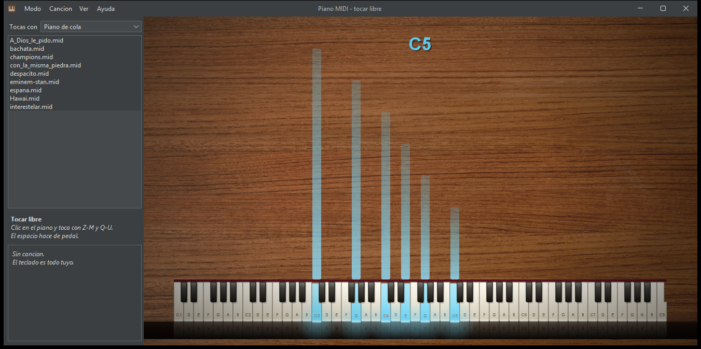
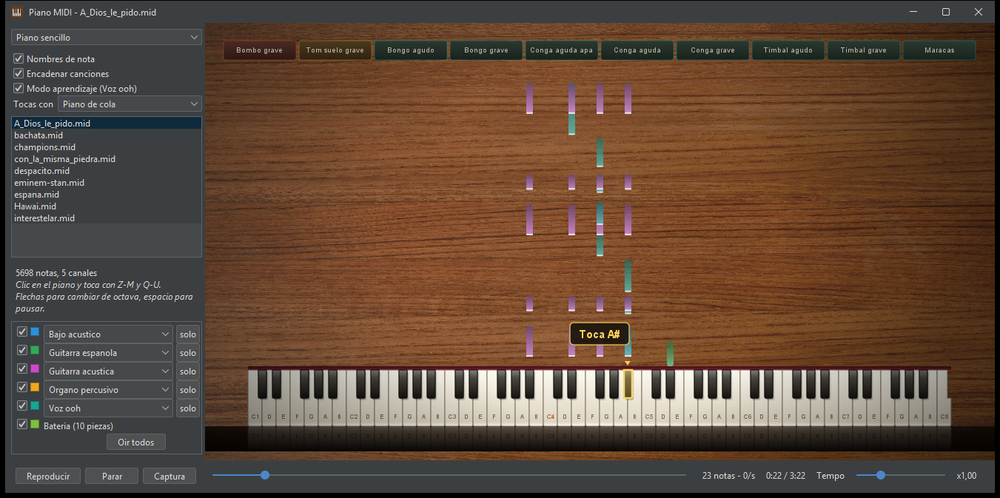
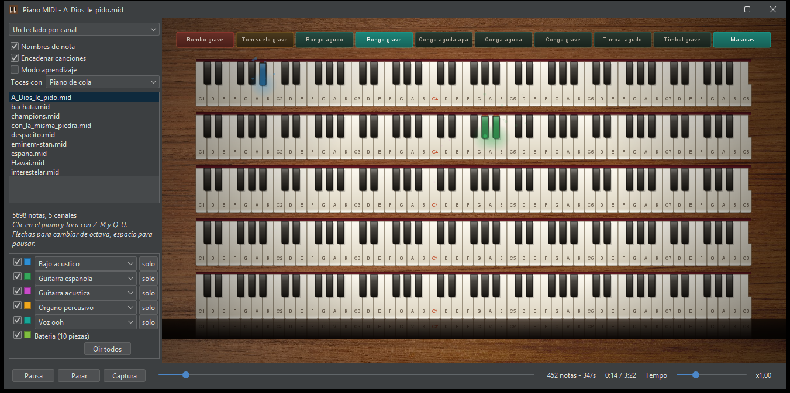

# Piano MIDI 🎹

Visualizador de ficheros MIDI en Java: las notas caen sobre un teclado que se
ilumina al ritmo de la canción, y también se puede tocar.



## 📋 Descripción

Proyecto académico grupal realizado para el Grado Superior en Desarrollo de
Aplicaciones Multiplataforma (DAM) en el IES Hermenegildo Lanz (Granada).

## 🎛️ Cuatro modos de uso

Se eligen en el menú **Modo**, o con `Ctrl+1` a `Ctrl+4`.

| Modo | Qué hace |
|---|---|
| **Ver una canción** | Un teclado con las notas cayendo |
| **Ver por canales** | Un teclado por cada canal de la canción |
| **Aprender a tocarla** | Se para y espera a que toques la nota que viene |
| **Tocar libre** | Sin canción: el teclado para ti |

### Tocar libre

Sin ninguna canción cargada. Lo que toques deja una barra que crece hacia arriba
mientras mantienes la tecla y se desvanece al soltarla, con el nombre de la
última nota en grande. El espacio hace de pedal de resonancia.



## ✨ Qué hace

- **Notas cayendo** — barras de color que bajan y llegan a su tecla justo cuando
  esa nota empieza a sonar. La altura de cada barra es su duración.
- **Batería** — los golpes del canal 10 como pads con el nombre de cada pieza.
  Se montan solo los que la canción usa. Antes ese canal se descartaba entero:
  eran el **35 % de todas las notas**.
- **Modo aprendizaje** — la canción se para y espera a que toques la nota que
  viene, estilo Synthesia.
- **Un teclado por canal** — modo alternativo con un teclado para cada canal
  MIDI de la canción, cada uno con su color.
- **Se puede tocar** — con el teclado del ordenador o con el ratón, eligiendo
  entre los 128 instrumentos de General MIDI.
- **Mezcla** — silenciar o aislar cualquier canal, y cambiar el instrumento de
  cualquier pista sin tocar el fichero.
- **Transporte** — pausa, salto a cualquier punto y tempo de x0,25 a x3.

### Modo aprendizaje

Señala la tecla que toca con contorno, flecha y un cartel, y no sigue hasta que
la pulses. Vigila un solo canal —en estas canciones hay hasta trece sonando a la
vez y no habría manera de tocarlos todos— y elige el que más se parece a la
melodía. Al activarlo adelanta hasta la primera nota que hay que tocar.



### Un teclado por canal



## ▶️ Cómo se lanza

```powershell
.\ejecutar-swing.ps1
```

El script comprueba el JDK, se baja FlatLaf la primera vez y compila. Si
prefieres hacerlo a mano:

```powershell
$fuentes = Get-ChildItem -Recurse src -Filter *.java | ForEach-Object { $_.FullName }
$fuentes | Set-Content "$env:TEMP\fuentes.txt" -Encoding ascii
javac -encoding UTF-8 -cp lib\flatlaf-3.7.2.jar -d out "@$env:TEMP\fuentes.txt"
java -cp "out;lib/*" jd.piano.programa.ProgramaSwing
```

> El `-Encoding ascii` no es un descuido: con `utf8`, PowerShell mete un BOM al
> principio del fichero y `javac` lo rechaza.

## ⚙️ Requisitos

- **JDK 21 o superior.** Se usan `record`, `List.getFirst()`, `instanceof` con
  patrón y bloques de texto.
- **FlatLaf** para el aspecto de los controles. Es opcional: si el JAR no está,
  el programa arranca con el aspecto de serie de Swing. Ver
  [lib/LEEME.md](lib/LEEME.md).
- Un dispositivo MIDI en el sistema. El sintetizador que trae Java sirve.

## ⌨️ Controles

| | |
|---|---|
| Clic en el piano | Le da el foco al teclado |
| `Z` `S` `X` `D` `C` `V` `G` `B` `H` `N` `J` `M` | Una octava: las letras de abajo son blancas, las de encima negras |
| `Q` `2` `W` `3` `E` `R` `5` `T` `6` `Y` `7` `U` `I` | La octava siguiente |
| `←` `→` | Baja o sube una octava |
| Espacio | Pausa, o pedal de resonancia en el modo libre |
| `Ctrl+1` a `Ctrl+4` | Cambiar de modo |
| Clic y arrastre en las teclas | Toca con el ratón |

Lo que tocas suena por el canal 16, que es el que menos usan los ficheros MIDI,
así que no le cambia el instrumento a ninguna pista de la canción. Con el
desplegable **Tocas con** eliges cualquiera de los 128 instrumentos de General
MIDI: el banco que trae Java los tiene cargados desde el arranque.

## 🎵 Canciones

Las de la carpeta `canciones` salen solas en la lista. También se puede
**arrastrar un `.mid`** sobre la ventana.

## 🧱 Cómo está organizado

```
src/jd/piano/teclas/     el instrumento: teclas, medidas y estilo
  Tecla, TeclaBlanca1/2/3, TeclaNegra     una tecla y sus formas
  Piano                                   teclado abstracto
  MedidasTeclado, LayoutTeclados          tamaños y reparto en pantalla
  Estilo                                  paleta y nombres de nota

src/jd/piano/programa/   la aplicación
  PianoSencillo, MultiPiano               los dos dibujados de teclado
  Escena, Lienzo, VentanaPrincipal        dibujado y ventana
  Cascada, Particulas, Bateria            capas animadas
  ModoDeUso, BarraDeMenu                  los cuatro modos y el menu
  ModoAprendizaje                         esperar la nota correcta
  RastroLibre                             el rastro del modo libre
  Partitura, AnalisisMidi, Reproductor    el MIDI
  InstrumentosGM, PiezasPercusion         nombres de General MIDI
  SintetizadorTeclado                     tocar
```

Dos decisiones que explican casi todo lo demás:

**Las teclas son formas, no listas de vértices.** Cada blanca se construye
restando del cuerpo el hueco de las negras vecinas. Eso hace imposible
equivocarse en una coordenada, y de paso regala el saber en qué tecla se ha
hecho clic: basta preguntarle a la forma si contiene el punto.

**Se dibuja por frames, no acumulando.** El fondo y el teclado en reposo se
pre-componen en dos imágenes, y en cada frame solo se repintan las zonas donde
hay teclas encendidas. Sin eso no habría animación posible, y con 88 teclas no
se llegaría a 60 fps.

## ✅ Comprobaciones

```powershell
.\probar.ps1
```

90 comprobaciones automáticas que no necesitan pantalla. Vigilan lo que se
puede romper sin darse cuenta:

- Que las teclas **encajen exactas** a cualquier escala, sin pisarse ni dejar
  huecos. Es el invariante que ya se rompió una vez: `TeclaBlanca2` y `3`
  enumeraban vértices a mano y una coordenada mal metía una cuña blanca encima
  de la tecla negra vecina.
- Que el clic acierte la tecla, **barriendo los 129 074 puntos** de la
  superficie del teclado uno a uno.
- Que la conversión de pulsos a tiempo cuadre con la duración que declara Java,
  incluso en las canciones que cambian de tempo. Si se desviara, las notas
  cayendo se irían desincronizando.
- Que no se pierda ninguna nota al leer el fichero.
- El transporte entero: pausa, saltos con sus límites, tempo acotado.
- Que no queden notas encendidas para siempre, por ninguna de las tres vías por
  las que pasaba.
- Que buscar funcione **mientras suena**, no solo en pausa. El secuenciador de
  Java ignora el cambio de posición si está en marcha, así que pinchar en la
  barra de progreso no hacía nada, y ninguna comprobación lo cubría.
- El mapa completo de percusión y el montaje de los pads.
- Que el modo aprendizaje pare al llegar a un acorde y siga al tocarlo.
- Que los cuatro modos sean coherentes: no puede haber notas cayendo sin
  canción ni con varios teclados a la vez.
- Que el rastro del modo libre aparezca al tocar.

Lo que **no** cubren, porque no se puede automatizar sin pantalla ni oído: que
suene, que el ratón y el teclado respondan como esperas, y que vaya fluido.

## 🖱️ Acceso en el escritorio

```powershell
.\crear-acceso.ps1
```

Deja un **Piano MIDI** en el escritorio con su icono, que lo dibuja el propio
programa (`Iconos`) para que sea el mismo que el de la ventana.

El acceso llama a `lanzar.ps1`, que recompila **solo si has tocado el codigo** y
abre la ventana sin consola. Si algo falla avisa con un cuadro de dialogo, que si
no arranca sin consola y no se veria el error.

## 📷 Capturas

El botón **Captura**, o `Ctrl+G`, guarda lo que se ve en `capturas/` como PNG.

## 👥 Autores

Proyecto de grupo. *(Pendiente de completar con los nombres.)*
